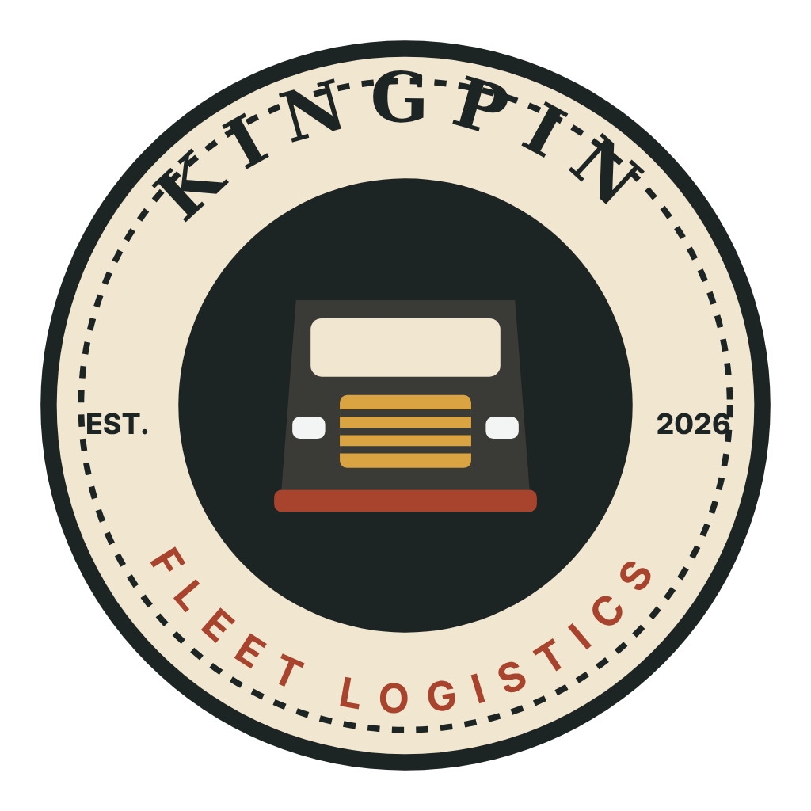

# Kingpin Fleet Logistics

Fleet management for **American Truck Simulator**. Kingpin reads your own saves and game files and turns them into the reports a real trucking company would run.

 [Download the latest release](https://github.com/OneExhaustedFather/Kingpin-Fleet-Management/releases)

Get **Kingpin-Setup.exe** (signed installer) or the portable zip. Windows 10/11 (64-bit) and American Truck Simulator are required.

## What it does
- **Overview:** Here's a snapshot of your company. Your number of garages, drivers, and trailers. A summary of your financial position including loans w/ details, revenue/net charts, and leaderboards to see how each garage/driver is doing compared to the rest.  
- **Garages:** visit your garage, see which trucks are assigned and how each driver is doing.  Hover over a truck plate or a driver name to get more details. Click on a drivers name to pull up their specific delivery history. 
- **Deliveries:** your full delivery history, *this does not bring back past deliveries unless you have a complete comprehensive save folder.  
- **GPS monitoring:** Want to watch your fleet in real time? GPS monitoring takes your game saves and live game time to simulate a fleet tracking software.  Allows you to click on drivers to see route info and highlight there route on the map. 
- **Route planner:** the design is to give you a more immersive experience, it pulls the job logs and creates the routes, it gets better as it sees more job listing to improve its forecast model. Please report any bugs with details to improve it. 
- **Revenue projections:** make projections based on improved production or reduced costs.  You can model increased or decreased production or costs or just forecast your next 90days based on current trends. 
- **Truck dashboard:** live speed, fuel and economy in three era styles. - this has no purpose other than telemetry testing; you can pop it out and choose between 3 dash styles. 
- **Truck and trailer configurator:** plan your next truck and compare it to your current fleet, save custom configs to compare against each other to find the perfect setup for your next investment. 

## Read-only, always
Kingpin never changes your saves, game files or mods. It only reads them. No game data ships with Kingpin; it builds its truck, cargo and company lists from your own install on first launch, and again after game updates or new DLC.
If you identify an asset that does not correctly display in the app, please report it, a screen grab is great or a link to the mod.  I'll download and adjust.  If it's a paid mod file it's possible the creators have locked it.  I would need to reach out for permission so include mod maker as well. 

Live GPS tracking uses the ATS telemetry plugin, which the installer offers to set up (optional), the GPS tracking is still there just will be slow to update as it'll rely on save data. 

## Status
**Alpha.** Expect rough edges. Euro Truck Simulator 2 support may come later.

## Feedback
Found a bug or have an idea? Either:
- **Email**     $Kingpin.bugreport@gmail.com$  (no account needed), or
- open an [issue](https://github.com/OneExhaustedFather/Kingpin-Fleet-Management/issues) if you have a GitHub account.

Please include:
1. Kingpin version (Settings → About)
2. What you did
3. What you expected
4. What happened instead
5. A screenshot, if you can

Save files aren't needed. Please don't attach them unless we ask.

Problems with a **modded truck or trailer** in the configurator: use the Report button in the app, or [Kingpin-reports](https://github.com/OneExhaustedFather/Kingpin-reports).
